# III.9 · Repositorios, generación de código y documentación, metodologías, pruebas y control de versiones

Este tema recoge las herramientas y métodos con los que se **organiza el trabajo de desarrollo**: los **repositorios** (su estructura y actualización), la **generación de código y documentación**, las **metodologías de desarrollo** (Métrica v3, ciclos de vida clásicos y métodos ágiles como Scrum), las **pruebas** del software, los **programas de control de versiones** (Git, Subversion) y las **plataformas de desarrollo colaborativo** (GitHub, GitLab) con su integración continua. En el examen se pregunta en el cuestionario (definiciones de Métrica, Scrum, Manifiesto Ágil, comandos y conceptos de Git) y en todos los supuestos del bloque III (comandos de Git, herramientas de pruebas y de calidad, ficheros de configuración).

## Repositorios: estructura y actualización

### Qué es un repositorio

Un **repositorio** es un **almacén centralizado y versionado** de los artefactos de un proyecto. En control de versiones, es «el espacio que contiene el conjunto de archivos de un proyecto y el **historial completo de cambios** de cada uno, permitiendo almacenar, versionar y gestionar su evolución» (pregunta de 2026). Hay varios tipos:

| Tipo | Contenido | Ejemplos |
|---|---|---|
| **De código fuente** | Ficheros fuente y su historial | Repositorios Git, Subversion o Mercurial |
| **De artefactos o binarios** | Bibliotecas y paquetes compilados con su versión | Maven Central, Sonatype **Nexus**, JFrog **Artifactory**, npm, NuGet, PyPI |
| **De imágenes de contenedores** | Imágenes Docker/OCI | Docker Hub, Harbor, registros de GitLab y GitHub |
| **De paquetes del sistema operativo** | Paquetes `.deb` y `.rpm` con sus metadatos | Repositorios APT y DNF/YUM (tema IV.1) |
| **CASE o de metadatos** | Modelos, diagramas, diccionario de datos y especificaciones de las herramientas CASE | Repositorio de una herramienta CASE integrada; diccionario de datos |
| **De soluciones reutilizables** de las Administraciones | Aplicaciones y componentes para reutilizar | **Centro de Transferencia de Tecnología (CTT)** del PAe |

**Repositorio CASE**: núcleo de las herramientas CASE integradas (I-CASE). Su **estructura** la define un **metamodelo** (qué tipos de objetos —entidades, procesos, clases, diagramas— y relaciones admite) y guarda los modelos de todas las fases con control de **versiones**, **integridad** y **consistencia** entre diagramas, **control de accesos** y operaciones de **reserva y devolución** (*check-out/check-in*) para que varios analistas trabajen sobre los mismos modelos.

### Estructura de un repositorio Git

```text
proyecto/                 ← directorio de trabajo (working tree)
├── .git/                 ← el repositorio propiamente dicho
│   ├── objects/          ← base de datos de objetos: commits, trees, blobs y tags (comprimidos y con nombre SHA)
│   ├── refs/heads/       ← ramas locales          refs/tags/ ← etiquetas    refs/remotes/ ← ramas remotas
│   ├── HEAD              ← referencia a la rama (o commit) actual
│   ├── index             ← área de preparación (staging area)
│   ├── logs/             ← reflogs: historial de cambios de las referencias
│   ├── config            ← configuración del repositorio (remotos, ramas)
│   └── hooks/            ← scripts que se ejecutan ante eventos (pre-commit, pre-push…)
├── .gitignore            ← ficheros que Git debe ignorar
└── README.md             ← descripción del proyecto, cómo arrancarlo y colaborar
```

Según la documentación oficial (*gitdatamodel*), las operaciones de Git usan **cuatro tipos de datos**: **objetos** (*objects*), **referencias** (*references*), el **índice** (*index* o área de preparación) y los ***reflogs*** (supuesto de 2026). Hay **cuatro tipos de objetos**: ***commit*** (instantánea con el árbol, los padres, autor, fecha y mensaje), ***tree*** (un directorio), ***blob*** (el contenido de un fichero) y ***tag*** anotada.

- Un **repositorio *bare*** (`git init --bare`) contiene solo el contenido de `.git`, **sin directorio de trabajo**: es el que se usa como **repositorio central remoto** al que todos envían cambios (pregunta de 2024).
- En **Subversion** la estructura convencional es `trunk/` (línea principal), `branches/` y `tags/`, y los cambios se numeran con **revisiones** globales.

### Actualización de un repositorio

- **Centralizado** (CVS, Subversion): *checkout* (obtener una copia de trabajo), *update* (traer los cambios del servidor), *commit* (enviar los cambios **directamente** al servidor central), resolución de conflictos y bloqueos opcionales.
- **Distribuido** (Git, Mercurial): cada desarrollador tiene **una copia completa del repositorio**; los cambios se confirman en local (`commit`) y se sincronizan con los remotos (`fetch`, `pull`, `push`).
- **Repositorios de artefactos**: publicación de versiones (`mvn deploy`, `npm publish`, `dotnet nuget push`) con **versionado semántico** (**SemVer 2.0.0**: `MAYOR.MENOR.PARCHE`, donde MAYOR cambia con incompatibilidades, MENOR con funcionalidad compatible y PARCHE con correcciones).

### Repositorios de software de las Administraciones

La **Ley 40/2015** obliga a compartir y reutilizar aplicaciones:

- **Art. 157**: las Administraciones ponen a disposición de las demás las aplicaciones de las que son titulares; pueden declararlas de **fuentes abiertas**; y **antes de adquirir, desarrollar o mantener** una aplicación deben **consultar el directorio general de aplicaciones** de la AGE, estando **obligadas a reutilizar** una solución disponible salvo que justifiquen su no reutilización por eficiencia.
- **Art. 158**: las Administraciones mantienen **directorios actualizados de aplicaciones** para su libre reutilización, interoperables con el **directorio general de la AGE**.

Ese directorio es el **Centro de Transferencia de Tecnología (CTT)** del Portal de Administración Electrónica. El Esquema Nacional de Interoperabilidad regula el licenciamiento (preferentemente con la licencia pública de la Unión Europea, **EUPL**) y los directorios de aplicaciones reutilizables.

## Generación de código y documentación

### Herramientas CASE y desarrollo dirigido por modelos

Las herramientas **CASE** (*Computer-Aided Software Engineering*) automatizan tareas del ciclo de vida:

| Tipo | Fases | Funciones |
|---|---|---|
| **Upper CASE** (alto nivel) | Planificación, análisis y diseño | Diagramas (DFD, E-R, UML), diccionario de datos, comprobación de consistencia |
| **Lower CASE** (bajo nivel) | Diseño detallado, **generación de código**, pruebas | Generadores de código y de esquemas de base de datos, depuradores |
| **I-CASE** (integradas) | Todo el ciclo | Repositorio común entre fases |

- **Ingeniería directa** (del modelo al código), **inversa** (del código o la base de datos al modelo) y de **ida y vuelta** (*round-trip*, mantener ambos sincronizados).
- **MDA** (*Model Driven Architecture*, OMG): modelo independiente de la computación (CIM) → **modelo independiente de la plataforma (PIM)** → **modelo específico de plataforma (PSM)** → código, mediante transformaciones automáticas.

### Generación de código en la práctica

| Técnica | Ejemplos |
|---|---|
| **Andamiaje** (*scaffolding*) de proyectos | Spring Initializr, `dotnet new`, Angular CLI (`ng new`, `ng generate component`), generadores de Rails y JHipster |
| A partir de contratos e interfaces | `wsimport` (WSDL → clases Java), OpenAPI Generator (OpenAPI → clientes y servidores), `protoc` (Protocol Buffers), `xjc` (XSD → clases) |
| A partir de la base de datos | Ingeniería inversa de entidades JPA o EF Core (`dotnet ef dbcontext scaffold`) |
| Procesadores de anotaciones y plantillas | Lombok, MapStruct, generadores de código fuente de C# |
| Plataformas *low-code* y *no-code* | Aplicaciones con modelos visuales (Power Apps, OutSystems, Mendix) |
| **Asistentes de IA generativa** | Completado y generación de código con modelos de lenguaje; exigen **revisión humana**, análisis de seguridad y atención a licencias y datos sensibles |

### Documentación del software

- **Documentación en el código**: comentarios estructurados que generan documentación de la API.

```java
/**
 * Calcula el número de matrículas de un alumno.
 *
 * @param idAlumno identificador del alumno
 * @return número de matrículas (0 si no tiene)
 * @throws IllegalArgumentException si el identificador es negativo
 * @since 2.1
 */
public int calcularMatriculas(long idAlumno) { … }
```

| Herramienta | Lenguaje | Sintaxis |
|---|---|---|
| **Javadoc** | Java | Comentarios `/** … */` con etiquetas `@param`, `@return`, `@throws`, `@author`, `@since`, `@deprecated`, `@see` |
| Comentarios XML y DocFX | C# | `///` con `<summary>`, `<param>`, `<returns>` |
| JSDoc / TSDoc | JavaScript, TypeScript | `/** @param {string} dni */` |
| Docstrings, Sphinx, pydoc | Python | `"""…"""` |
| Doxygen | C, C++ y otros | Varios estilos |
| **OpenAPI/Swagger** | API REST | Documentación interactiva generada desde la especificación o desde anotaciones |

- **Documentación del proyecto**: **`README.md`** (propósito, cómo instalar, arrancar y contribuir; supuesto de 2024), `CHANGELOG`, `CONTRIBUTING`, licencia, **registros de decisiones de arquitectura** (ADR), wikis y documentación como código (*docs as code*: Markdown o AsciiDoc versionados en el repositorio y publicados con MkDocs, Docusaurus o Antora). Diagramas como código: PlantUML, Mermaid.
- **Documentación de Métrica v3**: catálogo de requisitos, especificaciones de análisis y diseño, plan de pruebas, **manuales de usuario** (tarea **CSI 6.1**, en la que participa el **Equipo del Proyecto**; pregunta de 2023), manual de explotación, plan de formación y de implantación.
- **Calidad y estilo del código**: **analizadores estáticos** (SonarQube, PMD, Checkstyle, SpotBugs, ESLint, Pylint), **formateadores** (**Prettier**, google-java-format, `dotnet format`) y revisiones de código. Mercurial es un control de versiones, no una herramienta de calidad (supuesto de 2024).

## Metodologías de desarrollo

### Ciclos de vida clásicos

| Modelo | Características | Ventajas | Inconvenientes |
|---|---|---|---|
| **En cascada** (Royce, 1970) | Fases secuenciales: requisitos, análisis, diseño, codificación, pruebas, mantenimiento | Sencillo, muy documentado | Rígido; el usuario ve el producto al final; los errores de requisitos son caros |
| **En V** | Cada fase de desarrollo tiene su nivel de pruebas (requisitos ↔ aceptación, diseño ↔ sistema e integración, codificación ↔ unitarias) | Planifica las pruebas desde el principio | Igual de rígido |
| **Prototipado** | Prototipos rápidos para aclarar requisitos (desechables o evolutivos) | Reduce la incertidumbre | Riesgo de quedarse con el prototipo |
| **Incremental** | Se entregan partes funcionales sucesivas | Entregas tempranas | Requiere una buena arquitectura inicial |
| **En espiral** (Boehm) | Iteraciones con cuatro cuadrantes: objetivos, **análisis de riesgos**, desarrollo y planificación | Gestiona el riesgo | Complejo; exige experiencia en riesgos |
| **RAD** (James Martin) | Desarrollo rápido con herramientas y prototipos | Rapidez | Para sistemas acotados |
| **Proceso Unificado** (RUP) | Iterativo e incremental, dirigido por casos de uso y centrado en la arquitectura; fases de **inicio, elaboración, construcción y transición** | Equilibrio entre control y flexibilidad | Pesado si no se adapta |


*Figura: modelos de ciclo de vida en cascada, en V, incremental y en espiral.*

Normas de referencia: **ISO/IEC/IEEE 12207:2017** (procesos del ciclo de vida del *software*), ISO/IEC/IEEE 15288 (de sistemas), **CMMI** (modelo de madurez: niveles 1 inicial, 2 gestionado, 3 definido, 4 gestionado cuantitativamente y 5 en optimización) e ISO/IEC 33000 (evaluación de procesos, sucesora de SPICE/15504).

### Métrica v3

**Métrica versión 3** es la metodología de planificación, desarrollo y mantenimiento de sistemas de información del Ministerio de Administraciones Públicas, basada en la norma **ISO 12207**; cubre el desarrollo **estructurado** y el **orientado a objetos**.

| Procesos principales | Actividades |
|---|---|
| **PSI** Planificación de Sistemas de Información | Plan estratégico de sistemas (PSI 1 a 9) |
| **Desarrollo** | **EVS** Estudio de Viabilidad del Sistema → **ASI** Análisis → **DSI** Diseño → **CSI** Construcción → **IAS** Implantación y Aceptación |
| **MSI** Mantenimiento de Sistemas de Información | Registro, análisis, preparación y seguimiento de las peticiones |

**Interfaces** (procesos de apoyo que acompañan a los principales): **Gestión de Proyectos** (GP), **Seguridad** (SEG), **Gestión de la Configuración** (GC) y **Aseguramiento de la Calidad** (CAL).



*Figura: procesos principales e interfaces de Métrica v3.*

- **CSI** (Construcción): preparación del entorno, **generación del código** (CSI 2), **pruebas unitarias** (CSI 3), **de integración** (CSI 4) y **del sistema** (CSI 5), **manuales de usuario** (CSI 6), formación (CSI 7), migración (CSI 8) y aprobación (CSI 9).
- **IAS** (Implantación): plan de implantación, formación, incorporación al entorno de operación, carga de datos, **pruebas de implantación** (IAS 5), **pruebas de aceptación** (IAS 6), preparación del mantenimiento, **acuerdo de nivel de servicio**, aprobación y **paso a producción**.
- **Tipos de mantenimiento**: **correctivo** (corregir errores), **evolutivo** (nuevas necesidades del usuario), **adaptativo** (cambios del entorno: *hardware*, sistema operativo, SGBD) y **perfectivo** (mejorar la calidad interna: reestructuración, rendimiento). Métrica solo abarca el **correctivo y el evolutivo**.
- **Gestión de la configuración**: mantener la integridad de los productos a lo largo del ciclo de vida, identificar los **elementos de configuración**, registrar sus versiones y controlar los cambios.

### Métodos ágiles

El **Manifiesto Ágil** (Snowbird, Utah, **2001**, 17 firmantes) establece **cuatro valores**:

| Valoramos más… | …que |
|---|---|
| **Individuos e interacciones** | procesos y herramientas |
| **Software funcionando** | documentación extensiva |
| **Colaboración con el cliente** | negociación contractual |
| **Respuesta ante el cambio** | seguir un plan |

Y **doce principios**: satisfacer al cliente con entregas **tempranas y continuas** de *software* con valor; **aceptar los requisitos cambiantes, incluso en etapas tardías** (pregunta de 2024); entregar *software* funcional con frecuencia (de dos semanas a dos meses); negocio y desarrolladores **trabajan juntos a diario**; proyectos en torno a **individuos motivados**; comunicación **cara a cara**; **el *software* funcionando es la medida principal de progreso**; **ritmo sostenible**; excelencia técnica y buen diseño; **simplicidad, el arte de maximizar la cantidad de trabajo NO realizado** (es falso «realizado», pregunta de 2021); **equipos autoorganizados**; y **reflexión periódica** para mejorar.

### Scrum

**Scrum** es un marco de trabajo ágil, empírico (transparencia, inspección y adaptación), definido en la **Guía de Scrum** de Ken Schwaber y Jeff Sutherland (versión vigente: **noviembre de 2020**).

| Elemento | Detalle |
|---|---|
| **Equipo Scrum** | Normalmente **10 personas o menos**, multifuncional y autogestionado, sin subequipos ni jerarquías. Tres responsabilidades: **Product Owner**, **Scrum Master** y **Developers** (pregunta de 2026: «Scrum Master» es un rol del equipo; *stakeholder* no) |
| **Product Owner** | Una persona (no un comité); **maximiza el valor** del producto y gestiona el *Product Backlog* (objetivo del producto, elementos y su orden) |
| **Scrum Master** | Establece Scrum, enseña y hace de *coach*, **elimina impedimentos** y cuida de que los eventos se celebren y respeten sus tiempos; es un **líder al servicio** del equipo |
| **Developers** | Crean el incremento, elaboran el *Sprint Backlog*, cuidan la calidad mediante la **Definición de Terminado** |

| Evento | Duración máxima (sprint de un mes) | Para qué |
|---|---|---|
| **Sprint** | **Un mes o menos** | Contenedor de los demás eventos; produce un incremento |
| **Sprint Planning** | 8 horas | Qué se hará (objetivo del sprint) y cómo |
| **Daily Scrum** | **15 minutos** | Los *Developers* inspeccionan el progreso hacia el objetivo del sprint y adaptan el plan |
| **Sprint Review** | 4 horas | Inspeccionar el **incremento** con los interesados y adaptar el *Product Backlog* |
| **Sprint Retrospective** | 3 horas | Inspeccionar **cómo fue el sprint** (personas, interacciones, procesos, herramientas, Definición de Terminado) y planificar **mejoras**: es donde se comenta una **mala práctica** para no repetirla (supuesto de 2024) |

| Artefacto | Compromiso |
|---|---|
| ***Product Backlog*** (lista ordenada de lo necesario para el producto) | **Objetivo del producto** (*Product Goal*) |
| ***Sprint Backlog*** (objetivo del sprint + elementos elegidos + plan) | **Objetivo del sprint** (*Sprint Goal*) |
| **Incremento** (paso hacia el objetivo del producto, utilizable) | **Definición de Terminado** (*Definition of Done*) |


*Figura: eventos, artefactos con sus compromisos y responsabilidades de Scrum según la Guía de 2020.*

Prácticas habituales (no obligatorias en la Guía): **historias de usuario** («Como *rol* quiero *funcionalidad* para *beneficio*», criterios **INVEST**), estimación en **puntos de historia** con ***planning poker***, **velocidad**, gráficos *burndown* y refinamiento del *backlog*.

### Otros métodos ágiles y prácticas

| Método | Claves |
|---|---|
| **XP** (*Extreme Programming*, Kent Beck) | **Programación en parejas**, **TDD**, refactorización, **integración continua**, entregas pequeñas, diseño simple, propiedad colectiva del código, estándares de codificación, cliente in situ y ritmo sostenible |
| **Kanban** (David J. Anderson) | **Visualizar** el flujo en un tablero, **limitar el trabajo en curso** (WIP), gestionar el flujo y mejorar continuamente; sin iteraciones fijas |
| **Lean** (Poppendieck) | Eliminar desperdicio, amplificar el aprendizaje, decidir lo más tarde posible, entregar lo antes posible, potenciar el equipo, integridad, visión de conjunto |
| DSDM | Priorización **MoSCoW** (*Must, Should, Could, Won't*) y plazos fijos (*timeboxing*) |
| FDD, Crystal | Desarrollo dirigido por funcionalidades; familia de métodos según tamaño y criticidad |
| A escala | **SAFe**, LeSS, Nexus, Scrum@Scale |
| **DevOps** | Unir desarrollo y operaciones: cultura, automatización, medición y compartir (CALMS); **CI/CD**, infraestructura como código, monitorización; **DevSecOps** integra la seguridad (tema III.8) |
| **TDD** (desarrollo guiado por pruebas) | Ciclo **rojo → verde → refactorizar**: primero la prueba que falla, luego el código mínimo, después mejorar |
| **BDD** (desarrollo guiado por comportamiento) | Escenarios en lenguaje natural con **Gherkin** (*Given-When-Then*, «Dado-Cuando-Entonces») automatizados con **Cucumber** |

**Matriz RACI** (gestión de proyectos; pregunta de 2026): asigna para cada tarea quién es ***Responsible*** (la ejecuta), ***Accountable*** (rinde cuentas y aprueba; uno solo por tarea), ***Consulted*** (se le consulta) e ***Informed*** (se le informa). Otras técnicas de gestión de Métrica: **PERT**, **Gantt**, **WBS** (estructura de descomposición del trabajo) y estimación por **puntos función** (Albrecht, Mark II).

## Pruebas

### Conceptos

Probar es ejecutar el *software* con la intención de **encontrar defectos** y comprobar que cumple los requisitos. **Verificación**: ¿estamos construyendo el producto **correctamente** (conforme a la especificación)? **Validación**: ¿estamos construyendo el producto **correcto** (lo que necesita el usuario)? Principios generales (ISTQB): las pruebas muestran la presencia de defectos, no su ausencia; las pruebas exhaustivas son imposibles; probar pronto ahorra; los defectos se agrupan; las mismas pruebas pierden eficacia (paradoja del pesticida); dependen del contexto; la ausencia de errores no garantiza utilidad.

Norma de referencia: **ISO/IEC/IEEE 29119** (conceptos, procesos, documentación, técnicas y pruebas dirigidas por palabras clave).

### Tipos de pruebas según Métrica v3

| Tipo | Objetivo (Métrica v3) | Quién / cuándo |
|---|---|---|
| **Unitarias** | Verificar la **funcionalidad y estructura de cada componente individualmente** una vez codificado; sobre todo **caja blanca**, complementada con caja negra | Desarrolladores (CSI 3) |
| **De integración** | Verificar el **correcto ensamblaje** entre componentes ya probados unitariamente: que **interactúan correctamente a través de sus interfaces**, internas y externas, cubren la funcionalidad y se ajustan a los requisitos no funcionales (preguntas de 2023 y 2024) | CSI 4. Estrategias **incrementales** (*top-down* con componentes auxiliares que simulan a los invocados; *bottom-up* con componentes conductores; combinadas) o **no incremental** (*big bang*) |
| **Del sistema** | Comprobar la integración del sistema **globalmente** y sus interfaces con otros sistemas | CSI 5 |
| **De implantación** | Funcionamiento del sistema integrado de *hardware* y *software* **en el entorno de operación**: rendimiento, seguridad, operación, copias y recuperación | Equipo de operación (IAS 5) |
| **De aceptación** | Validar que el sistema cumple lo esperado y permitir al **usuario** decidir su **aceptación** por funcionalidad y rendimiento; pruebas de **caja negra** definidas por el usuario | Usuario (IAS 6) |
| **De regresión** | Eliminar el «**efecto onda**»: comprobar que los **cambios** sobre un componente **no introducen errores en otros no modificados** (pregunta de 2026) | Desarrollo y mantenimiento, tras cada cambio |

**Pruebas del sistema** en Métrica: **funcionales**, **de comunicaciones** (interfaces), **de rendimiento** (**tiempos de respuesta dentro de los intervalos especificados**; pregunta de 2021), **de volumen** (grandes volúmenes de datos), **de sobrecarga** (umbral límite de recursos con cargas masivas), **de disponibilidad de datos** (recuperación ante fallos sin perder integridad), **de facilidad de uso**, **de operación**, **de entorno** (interacción con otros sistemas del entorno) y **de seguridad** (control de acceso). No existen las «pruebas circunstanciales» (distractor de 2026).

### Técnicas de diseño de casos de prueba

| Enfoque | Qué mira | Técnicas |
|---|---|---|
| **Caja blanca** (estructural) | La **estructura interna** del código | **Cobertura** de sentencias, de decisiones (ramas), de condiciones y de caminos; **complejidad ciclomática** de McCabe, V(G) = aristas − nodos + 2 = nodos de decisión + 1 (número de caminos independientes que hay que probar) |
| **Caja negra** (funcional) | **Solo entradas y salidas**, sin mirar el interior | **Clases de equivalencia**, **valores límite**, tablas de decisión, transición de estados, casos de uso, conjetura de errores |
| Caja gris | Combinación | Pruebas con conocimiento parcial del interior |

> Valores límite para una nota válida entre 0 y 10 con dos decimales: probar −0,01, 0, 0,01, 9,99, 10 y 10,01; clases de equivalencia: una válida (0-10) y dos inválidas (< 0 y > 10), más los valores no numéricos.

**Otros tipos y conceptos**: pruebas de **humo** (*smoke*, comprobación rápida tras un despliegue), exploratorias, **alfa** (usuarios en el entorno del desarrollador) y **beta** (usuarios reales en su entorno), de **carga** y **estrés**, de seguridad (SAST, DAST, tema III.8), de **accesibilidad**, de extremo a extremo (E2E) y de mutación. **Pirámide de pruebas** (Mike Cohn): muchas unitarias, menos de integración o servicio y pocas de interfaz. **Dobles de prueba**: *dummy*, *stub* (respuestas predefinidas), *spy*, ***mock*** (verifica las interacciones) y *fake*.

### Herramientas de pruebas

| Herramienta | Uso |
|---|---|
| **JUnit** (Java), TestNG | Pruebas unitarias: `@Test`, `assertEquals`, `assertThrows` |
| **Mockito** | Objetos simulados (*mocks*) en Java |
| **NUnit** (`[TestFixture]`, `[Test]`), xUnit.net (`[Fact]`, `[Theory]`), MSTest (`[TestClass]`, `[TestMethod]`) | Pruebas unitarias en .NET (supuesto de 2026) |
| **Jest**, Jasmine y Karma, Vitest | Pruebas de JavaScript; en Angular las pruebas van en ficheros **`.spec.ts`** (supuesto de 2026) |
| **Selenium WebDriver**, Cypress, Playwright | **Automatizar pruebas en el navegador** (supuesto de 2023) |
| **Cucumber** | BDD con Gherkin |
| **JMeter**, Gatling, k6, Locust, LoadRunner | Pruebas de **carga y estrés** simulando **usuarios concurrentes** (pregunta de 2021) |
| Postman, SoapUI | Pruebas de API |
| **TestLink**, Xray, TestRail | **Gestión** de casos y planes de prueba |
| **Avocado** | *Framework* de pruebas automatizadas |
| JaCoCo, Coverlet | Cobertura de código |
| SonarQube | Calidad y seguridad del código (incluye cobertura) |

OneTrust es una plataforma de privacidad y cumplimiento normativo, no de pruebas (2026); Foglight es de monitorización del rendimiento; Cactus fue un *framework* de pruebas de servidor de Apache, ya retirado.

```java
class AlumnoServiceTest {                                        // JUnit (Jupiter)
    @Test
    void calculaMatriculas() {
        AlumnoService service = new AlumnoService();
        assertEquals(3, service.calcularMatriculas(10L));        // valor esperado, valor obtenido
    }

    @Test
    void rechazaValoresNegativos() {
        AlumnoService service = new AlumnoService();
        assertThrows(IllegalArgumentException.class, () -> service.obtenerMatriculas(-1));
    }
}
```

```csharp
[TestFixture]                                                    // NUnit
public sealed class CalculadoraTests
{
    [Test]
    public void Suma_DosEnteros_DevuelveLaSuma() => Assert.That(new Calculadora().Sumar(2, 3), Is.EqualTo(5));
}
```

## Programas para control de versiones

### Conceptos

Un **sistema de control de versiones** (VCS) registra los cambios de los ficheros a lo largo del tiempo para **recuperar versiones anteriores**, saber **quién cambió qué y cuándo**, trabajar **en paralelo** con ramas y **fusionar** el trabajo.

| | Centralizado | Distribuido |
|---|---|---|
| Ejemplos | **CVS**, **Subversion (SVN)**, Perforce, TFVC | **Git**, **Mercurial** (hg), Bazaar, Fossil |
| Repositorio | Uno central; los clientes tienen una copia de trabajo | Cada clon es un **repositorio completo** con todo el historial |
| Trabajo sin conexión | No se puede confirmar | Sí (commits locales) |
| Ramas | Más costosas | Muy ligeras |
| Punto único de fallo | El servidor | No (cualquier clon sirve de copia) |

No son control de versiones: JMeter (pruebas de carga), Selenium (pruebas en navegador) ni Cucumber (BDD) (preguntas de 2023 y 2024). **GitLab y GitHub** son plataformas basadas en Git y sí se usan para el control de versiones.

### Git

Creado por **Linus Torvalds en 2005** para el núcleo Linux. Guarda **instantáneas** (no diferencias) identificadas por un *hash*. Tres estados de los ficheros y tres zonas:

| Estado | Zona | Significado |
|---|---|---|
| **Modificado** (*modified*) | Directorio de trabajo | Cambiado pero sin preparar |
| **Preparado** (***staged***) | **Área de preparación** (índice) | **Marcado para incluirse en el próximo *commit*** (pregunta de 2026), con `git add` |
| **Confirmado** (*committed*) | Repositorio local (`.git`) | Guardado en el historial con `git commit` |

Un ***commit*** es **almacenar una nueva instantánea del estado del proyecto en el historial** (pregunta de 2021).

| Orden | Función |
|---|---|
| `git init` / `git init --bare` | Crear un repositorio (con o sin directorio de trabajo) |
| **`git clone <url>`** | **Copiar un repositorio remoto** completo (supuesto de 2026: equipo nuevo) |
| `git status` | Estado de los ficheros |
| `git add <fichero>` | Pasar cambios al área de preparación |
| **`git commit -m "mensaje"`** | **Guardar en el repositorio local una instantánea de los cambios preparados** (pregunta de 2026) |
| **`git log`** | **Mostrar el historial de *commits*** (supuesto de 2021) |
| `git diff` | Diferencias entre trabajo, índice y *commits* |
| `git branch`, `git switch` (o `git checkout`) | Crear, listar y cambiar de rama |
| **`git merge <rama>`** | **Fusionar** otra rama en la actual (supuesto de 2023: integrar dos funcionalidades) |
| `git rebase <rama>` | Reaplicar los *commits* sobre otra base (historial lineal; no reescribir historial compartido) |
| **`git cherry-pick <commit>`** | **Aplicar un *commit* concreto** en la rama actual (supuesto de 2026) |
| **`git fetch`** | **Descarga** objetos y referencias del remoto y **actualiza las ramas de seguimiento remoto** (registrándolo en `.git/FETCH_HEAD`) **sin integrar** nada en la rama actual (supuesto de 2026) |
| `git pull` | `fetch` + **integración** (*merge* o *rebase*) en la rama actual |
| `git push` | **Subir** los *commits* locales al remoto |
| `git remote -v` | Ver los remotos |
| `git tag v1.2.0` | Etiquetar una versión |
| `git stash` | Guardar temporalmente cambios sin confirmar |
| `git revert <commit>` | Nuevo *commit* que **deshace** otro (seguro en historial compartido) |
| `git reset` | Mover la rama o deshacer la preparación (`--soft`, `--mixed`, `--hard`) |
| `git restore` | Descartar cambios del directorio de trabajo o del índice |
| `git bisect` | Búsqueda binaria del *commit* que introdujo un error |
| `git blame` | Quién cambió cada línea |
| `git reflog` | Historial de movimientos de las referencias (recuperar *commits* «perdidos») |

```bash
git clone https://git.ejemplo.gob.es/becas/api.git && cd api
git switch -c feature/subsanaciones          # nueva rama de funcionalidad
# … editar ficheros …
git add src/Subsanacion.java
git commit -m "feat: alta de subsanaciones"
git fetch origin                             # ver qué hay nuevo sin integrarlo
git rebase origin/develop                    # actualizar la rama sobre develop
git push -u origin feature/subsanaciones     # subir y abrir después una pull request
```

**Conflictos**: si dos ramas modifican las mismas líneas, Git marca el fichero con `<<<<<<<`, `=======` y `>>>>>>>`; se edita, se hace `git add` y se completa la fusión.

**Estrategias de ramas**:

| Estrategia | Ramas |
|---|---|
| **Git Flow** | `main` (producción), **`develop`** (integración), `feature/*`, `release/*`, `hotfix/*` |
| GitHub Flow | `main` siempre desplegable + ramas cortas con *pull request* |
| GitLab Flow | Añade ramas de entorno (`staging`, `production`) |
| ***Trunk-based development*** | Integración muy frecuente en la rama principal, con interruptores de funcionalidad |

Otras utilidades: **`.gitignore`**, *hooks* (`pre-commit`, `pre-push`), submódulos, Git LFS para ficheros grandes y mensajes de *commit* convencionales (`feat:`, `fix:`, `docs:`).

### Subversion

**Apache Subversion** (SVN) es un sistema **centralizado** (sucesor de CVS): `svn checkout`, `svn update`, `svn add`, `svn commit` (envía directamente al servidor), `svn log`, `svn diff`, `svn merge`, `svn copy` (crear ramas y etiquetas como copias baratas en `branches/` y `tags/`). Las revisiones se numeran de forma global y creciente.

## Plataformas de desarrollo colaborativo de software

### Funcionalidades

**GitHub** (Microsoft), **GitLab** (instalable en servidores propios, muy usado en la Administración), **Bitbucket** (Atlassian), **Azure DevOps** (Microsoft: Repos, Boards, Pipelines, Artifacts, Test Plans), Gitea, Forgejo y Codeberg ofrecen:

- **Alojamiento de repositorios** Git con control de acceso, ramas protegidas y revisiones obligatorias.
- ***Pull requests*** (GitHub, Bitbucket) o ***merge requests*** (GitLab): **propuesta para fusionar los cambios de una rama en otra** (pregunta de 2026), con **revisión de código**, comentarios, aprobaciones y comprobaciones automáticas. No confundir con `git pull`.
- ***Forks***: copia del repositorio en otra cuenta para contribuir sin permisos de escritura.
- **Gestión de incidencias** (*issues*), tableros Kanban, hitos, wikis y páginas (GitHub Pages).
- **Integración y entrega continuas** (CI/CD), registros de paquetes y de contenedores.
- Seguridad: análisis de dependencias (Dependabot), análisis estático (CodeQL), detección de secretos.

### Integración continua y entrega continua

- **Integración continua** (CI): integrar el código en la rama principal varias veces al día, con **compilación y pruebas automáticas** en cada cambio.
- **Entrega continua** (*continuous delivery*): el *software* está siempre listo para desplegarse; el paso a producción es una decisión manual. **Despliegue continuo** (*continuous deployment*): cada cambio que supera las pruebas se despliega automáticamente.
- **Canalización** (***pipeline***): etapas automatizadas (compilar, probar, analizar calidad y seguridad, empaquetar, desplegar en preproducción y producción).

| Herramienta | Configuración |
|---|---|
| **Jenkins** | Servidor de automatización de código abierto; ***pipelines*** definidos en un **`Jenkinsfile`** (supuesto de 2023) |
| **GitHub Actions** | *Workflows* en **`.github/workflows/`** con extensión **`.yml` o `.yaml`** (supuesto de 2026) |
| **GitLab CI/CD** | Fichero **`.gitlab-ci.yml`** en la raíz y ejecutores (*runners*) |
| Azure Pipelines | `azure-pipelines.yml` |
| Argo CD, Flux | Despliegue **GitOps** en Kubernetes |

```yaml
# .github/workflows/ci.yml
name: CI
on: [push, pull_request]
jobs:
  build:
    runs-on: ubuntu-latest
    steps:
      - uses: actions/checkout@v4
      - uses: actions/setup-java@v4
        with: { distribution: temurin, java-version: '25' }
      - run: mvn -B verify          # compila, ejecuta las pruebas y los análisis
```

**Construcción y dependencias**: **Maven** (el número de versión del proyecto está en **`pom.xml`**; supuesto de 2026), Gradle (`build.gradle`), npm (`package.json`), .NET (`.csproj`). RabbitMQ y Apache Kafka son sistemas de mensajería, no herramientas de CI.

## Normativa y estándares clave

| Norma o estándar | Qué regula | Puntos clave |
|---|---|---|
| **Métrica v3** (MAP) | Metodología de la Administración | Procesos PSI, EVS, ASI, DSI, CSI, IAS y MSI; interfaces GP, SEG, GC y CAL; pruebas unitarias, de integración, del sistema, de implantación, de aceptación y de regresión |
| **Ley 40/2015**, arts. 157 y 158 | Reutilización de aplicaciones de las Administraciones | Consultar el **directorio general de aplicaciones** (CTT) antes de adquirir o desarrollar; directorios actualizados e interoperables |
| ENI (RD 4/2010) | Interoperabilidad | Reutilización y licencias (EUPL) |
| **ISO/IEC/IEEE 12207:2017** | Procesos del ciclo de vida del *software* | Base de Métrica v3 |
| **ISO/IEC/IEEE 29119** | Pruebas del *software* | Conceptos, procesos, documentación y técnicas |
| CMMI e ISO/IEC 33000 | Madurez y evaluación de procesos | Niveles 1 a 5 |
| **Manifiesto Ágil** (2001) | Valores y principios ágiles | 4 valores y 12 principios |
| **Guía de Scrum** (noviembre de 2020) | Scrum | 3 responsabilidades, 5 eventos, 3 artefactos con sus compromisos |
| SemVer 2.0.0 | Numeración de versiones | MAYOR.MENOR.PARCHE |
| ENS (RD 311/2022), mp.sw.1 y mp.sw.2 | Seguridad en el desarrollo | Entornos separados, pruebas en preproducción, inspección del código |

## Lo que más cae en el examen

En los nueve exámenes analizados hay **46 preguntas** de este tema según nuestra clasificación: 33 de ingreso libre (5 en 2021, 6 en 2023, 5 en 2024, 7 en 2025 y **10** en el extraordinario de 2026) y 13 de promoción interna. Su peso crece en los supuestos recientes.

| Concepto | Preguntas | Exámenes |
|---|---|---|
| **Git y plataformas**: *commit*, *staged*, `log`, `merge`, `clone`, `fetch`, `cherry-pick`, repositorio *bare*, modelo de datos, qué es un repositorio, *pull request*, GitHub Actions | 15 | LI 2021, 2023, 2025 y 2025‑ext; PI 2023, 2024 y 2025 |
| **Pruebas**: tipos de Métrica (rendimiento, integración ×2, regresión), herramientas (JMeter, Selenium, NUnit, JUnit, `.spec.ts`, Jest, productos de pruebas) | 12 | LI 2021, 2023, 2024, 2025 y 2025‑ext; PI 2021 y 2025 |
| **Metodologías**: Manifiesto Ágil, Scrum (roles, *Retrospective*), RACI, manuales de usuario en Métrica | 8 | LI 2023, 2024 y 2025‑ext; PI 2021 y 2024 |
| **Qué no es control de versiones** / herramientas de calidad (JMeter, Mercurial, SonarQube, Prettier) | 6 | LI 2023 y 2024; PI 2023 y 2024 |
| **Construcción y CI/CD**: Jenkins, `pom.xml`, `README.md` | 5 | LI 2023, 2024 y 2025‑ext; PI 2024 |

Patrón: en el cuestionario, definiciones literales de Métrica v3 y del Manifiesto Ágil con una palabra cambiada; en el supuesto, la orden de Git o la herramienta adecuada para una situación (con opciones inventadas como `git banana-pick`).

## Trampas habituales

- **`git fetch`** descarga y actualiza las ramas remotas **sin integrar**; **`git pull`** descarga **e integra**; **`git push`** sube.
- **Staged** = preparado para el próximo *commit* (no «subido al servidor» ni «con conflictos»).
- **`git commit`** guarda en el repositorio **local**; para compartirlo hace falta `push`.
- **Repositorio *bare***: sin directorio de trabajo, para el repositorio central remoto (no es para *hooks* ni copias de seguridad).
- ***Pull request*** = propuesta de fusión entre ramas con revisión; no es `git pull` ni una vuelta atrás.
- Modelo de datos de Git: **objetos, referencias, índice y *reflogs***; los objetos son *commit*, *tree*, *blob* y *tag*.
- GitHub Actions: **`.github/workflows/`** con **`.yml` o `.yaml`**; GitLab: `.gitlab-ci.yml`; Jenkins: `Jenkinsfile`.
- **Integración** (Métrica) = ensamblaje e **interfaces** entre componentes; **sistema** = el conjunto y su relación con otros sistemas; **aceptación** = el usuario decide; **regresión** = que los cambios no rompan lo no modificado; **rendimiento** = tiempos de respuesta.
- **Caja blanca** mira la estructura interna; **caja negra**, solo entradas y salidas (un distractor de 2026 las intercambiaba). Las **unitarias** no sirven para la aceptación del usuario.
- **Retrospectiva** = mejorar el proceso; **Review** = revisar el incremento con los interesados; **Daily** = 15 minutos de los *Developers*; **Planning** = qué y cómo.
- Roles de Scrum: **Product Owner, Scrum Master y Developers**; no existen «Sprint Owner» ni «Scrum Planner».
- Manifiesto Ágil: el *software* funcionando es la **medida principal** de progreso (no la documentación); se aceptan requisitos cambiantes **incluso tarde**; simplicidad = maximizar el trabajo **no** realizado; equipos **autoorganizados** (no jerarquizados); negocio y desarrollo **a diario** (no semanalmente).
- **RACI** = *Responsible, Accountable, Consulted, Informed*.
- En Métrica, los **manuales de usuario** (CSI 6.1) los elabora el **Equipo del Proyecto**.
- Mantenimiento en Métrica: solo **correctivo** y **evolutivo** (adaptativo y perfectivo quedan fuera).
- **JMeter** = carga y estrés; **Selenium** = automatizar el navegador; **Cucumber** = BDD; **TestLink** = gestión de pruebas; **Mercurial**, **SVN** y **CVS** = control de versiones.

## Repaso rápido

- Repositorio = archivos + historial completo; tipos: código, artefactos (Nexus, Artifactory), contenedores, paquetes, CASE, CTT.
- Ley 40/2015: consultar el directorio general de aplicaciones antes de desarrollar y reutilizar si existe solución (art. 157); directorios actualizados (art. 158).
- CASE: Upper (análisis), Lower (código), I-CASE (integradas); MDA: CIM → PIM → PSM → código.
- Documentación: Javadoc (`/** */`, `@param`, `@return`), XML de C# (`///`), JSDoc, OpenAPI, `README.md`.
- Ciclos de vida: cascada, V, prototipos, incremental, espiral (riesgos), RAD, RUP (inicio, elaboración, construcción, transición).
- Métrica v3: PSI, EVS, ASI, DSI, CSI, IAS, MSI + GP, SEG, GC, CAL; basada en ISO 12207.
- Manifiesto Ágil (2001): 4 valores y 12 principios.
- Scrum (Guía 2020): Product Owner, Scrum Master, Developers; Sprint (≤ 1 mes), Planning (8 h), Daily (15 min), Review (4 h), Retrospective (3 h); Product Backlog, Sprint Backlog, Incremento.
- XP (parejas, TDD, CI), Kanban (WIP), Lean, DevOps; TDD rojo-verde-refactorizar; BDD Given-When-Then.
- Pruebas Métrica: unitarias, integración, sistema, implantación, aceptación, regresión; del sistema: funcionales, comunicaciones, rendimiento, volumen, sobrecarga, disponibilidad, facilidad de uso, operación, entorno, seguridad.
- Caja blanca (cobertura, McCabe) y caja negra (equivalencia, valores límite).
- Herramientas: JUnit, NUnit, Mockito, Jest, Selenium, Cucumber, JMeter, TestLink, SonarQube.
- VCS centralizados (CVS, SVN) y distribuidos (Git, Mercurial).
- Git: modificado → `add` (staged) → `commit`; `clone`, `fetch`, `pull`, `push`, `merge`, `rebase`, `cherry-pick`, `log`.
- Plataformas: GitHub, GitLab, Bitbucket, Azure DevOps; *pull/merge requests*; CI/CD con Jenkins, GitHub Actions, GitLab CI.

## Fuentes

- Portal de Administración Electrónica · Métrica v3: https://administracionelectronica.gob.es/pae_Home/pae_Documentacion/pae_Metodolog/pae_Metrica_v3.html
- Métrica v3 · Técnicas y prácticas (pruebas): https://administracionelectronica.gob.es/pae_Home/va/dam/jcr:da7d91fa-d6bd-467c-be32-a72e27c603b3/METRICA_V3_Tecnicas.pdf
- Ley 40/2015, de Régimen Jurídico del Sector Público, arts. 157 y 158 (BOE-A-2015-10566): https://www.boe.es/buscar/act.php?id=BOE-A-2015-10566
- PAe · Centro de Transferencia de Tecnología (CTT): https://administracionelectronica.gob.es/ctt
- Git, documentación oficial (*gitdatamodel*): https://git-scm.com/docs/gitdatamodel
- *Pro Git* (Chacon y Straub), libro oficial de Git: https://git-scm.com/book/es/v2
- Apache Subversion: https://subversion.apache.org/
- Manifiesto por el Desarrollo Ágil de Software y sus principios: https://agilemanifesto.org/iso/es/principles.html
- Schwaber y Sutherland, *The Scrum Guide* (2020): https://scrumguides.org/scrum-guide.html
- GitHub Docs, sintaxis de los *workflows* de GitHub Actions: https://docs.github.com/es/actions/reference/workflows-and-actions/workflow-syntax
- GitLab Docs, `.gitlab-ci.yml`: https://docs.gitlab.com/ci/yaml/
- Jenkins, *Pipeline*: https://www.jenkins.io/doc/book/pipeline/
- JUnit, guía de usuario: https://docs.junit.org/current/user-guide/
- NUnit, documentación: https://docs.nunit.org/
- Semantic Versioning 2.0.0: https://semver.org/lang/es/
- ISO/IEC/IEEE 29119-1:2022, pruebas de *software*: https://www.iso.org/standard/81291.html
