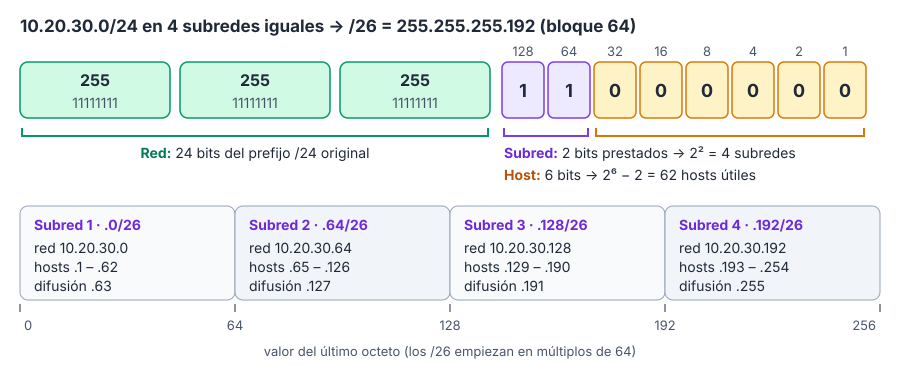

# IV.7 · Modelos OSI y TCP/IP. Protocolos TCP/IP

Las redes se diseñan por **capas**: cada una ofrece servicios a la superior y se apoya en la inferior, de modo que se pueden cambiar tecnologías sin rehacer todo. El **modelo de referencia OSI** de ISO (siete capas) es el marco conceptual con el que se describen las redes; el **modelo TCP/IP** (cuatro capas) es el que realmente usa Internet. Este tema recorre ambos modelos y su correspondencia, y después los **protocolos TCP/IP**: IPv4 y su **direccionamiento y subredes** (con ejercicios resueltos paso a paso), IPv6, ARP, ICMP, NAT, encaminamiento (RIP, OSPF, BGP), TCP, UDP y los principales protocolos de aplicación (DNS, DHCP). Es uno de los temas con más preguntas: el cálculo de subredes cae **en todas las convocatorias**.

## El modelo de referencia OSI de ISO

### Origen y conceptos

El **modelo de referencia de Interconexión de Sistemas Abiertos** (*Open Systems Interconnection*, OSI) lo publicó ISO en 1984; la versión vigente es la **ISO/IEC 7498-1:1994** (equivalente a la recomendación **UIT‑T X.200**). Es un **modelo de referencia**, no una pila de protocolos concreta: define **siete capas** y cómo se relacionan.

- Cada capa **N** ofrece **servicios** a la capa **N+1** y usa los de la capa **N−1**; las **entidades** de una capa se comunican con sus pares del otro sistema mediante un **protocolo**.
- Los servicios se ofrecen en **puntos de acceso al servicio** (SAP) mediante **primitivas**: ***Request*** (solicitud), ***Indication*** (indicación), ***Response*** (respuesta) y ***Confirm*** (confirmación). Un **servicio confirmado** usa las **cuatro**; uno **no confirmado**, solo *Request* e *Indication*.
- Cada capa añade su **cabecera** a los datos de la superior (**encapsulación**) formando su unidad de datos de protocolo (**PDU**).
- Los servicios pueden ser **orientados a conexión** (establecimiento, transferencia y liberación) o **sin conexión**.

### Las siete capas

| Nº | Capa | Función principal | PDU | Ejemplos |
|---|---|---|---|---|
| 7 | **Aplicación** | Servicios de red para las aplicaciones del usuario | Datos | HTTP, SMTP, DNS, FTP |
| 6 | **Presentación** | **Sintaxis de los datos**: negociación de la sintaxis de transferencia y **transformaciones como el cifrado y la compresión**, codificación de caracteres | Datos | ASN.1, TLS (en parte), MIME |
| 5 | **Sesión** | Control del **diálogo**: establecimiento de sesiones, turnos, puntos de **sincronización** y recuperación | Datos | RPC, NetBIOS |
| 4 | **Transporte** | Comunicación **extremo a extremo** entre procesos: segmentación, fiabilidad, control de flujo, puertos | Segmento | TCP, UDP |
| 3 | **Red** | **Direccionamiento lógico, encaminamiento y reenvío** de paquetes entre redes | Paquete | IP, ICMP, OSPF, RIP, BGP |
| 2 | **Enlace de datos** | Transferencia fiable entre nodos **adyacentes**: tramas, direcciones físicas (MAC), detección de errores (CRC), control de acceso al medio; subcapas **LLC** y **MAC** | Trama | Ethernet, Wi‑Fi, PPP |
| 1 | **Física** | Transmisión de **bits**: señales, medios, conectores, sincronización | Bit | Cables, RJ45, fibra, radio |

Orden **ascendente**: física, enlace, red, transporte, sesión, presentación y aplicación (regla mnemotécnica inglesa: *Please Do Not Throw Sausage Pizza Away*). Las capas 1 a 3 se ocupan de la red (están en todos los nodos intermedios) y las 4 a 7 son extremo a extremo.

## El modelo TCP/IP

El modelo TCP/IP (o de Internet) nació del proyecto ARPANET y se describe en las RFC 1122 y 1123. Tiene **cuatro capas**:

| Capa TCP/IP | Corresponde en OSI a | Protocolos |
|---|---|---|
| **Aplicación** | Aplicación, **presentación y sesión** (5, 6 y 7) | HTTP, DNS, SMTP, FTP, SSH, Telnet, DHCP, SNMP |
| **Transporte** | Transporte (4) | **TCP**, **UDP**, SCTP, QUIC (sobre UDP) |
| **Internet** (red) | Red (3) | **IP** (v4 y v6), **ICMP**, IGMP, IPsec |
| **Acceso a la red** (enlace) | **Enlace y física** (1 y 2) | Ethernet, Wi‑Fi, PPP; ARP en la frontera con Internet |


*Figura: correspondencia entre las capas OSI y TCP/IP, PDU de cada nivel y protocolos típicos.*

Muchos libros usan un modelo **híbrido de cinco capas** (física, enlace, red, transporte y aplicación). Diferencias con OSI: TCP/IP es una pila de protocolos real nacida de la práctica, mientras que OSI es un modelo teórico elaborado antes que sus protocolos (que apenas se implantaron); TCP/IP no tiene capas de sesión ni de presentación, y su capa de acceso a la red no está especificada en detalle.

```text
Aplicación     [ Datos HTTP ]
Transporte     [ Cab. TCP | Datos HTTP ]                                  → segmento
Internet       [ Cab. IP | Cab. TCP | Datos HTTP ]                        → paquete
Acceso a red   [ Cab. Ethernet | Cab. IP | Cab. TCP | Datos | FCS ]       → trama
Física         1011001110…                                               → bits
```

## Protocolo IPv4

### Características y cabecera

**IP** (RFC 791) es un protocolo **sin conexión** y **no fiable** («mejor esfuerzo»): cada paquete (datagrama) se encamina por separado y puede perderse, duplicarse o llegar desordenado; la fiabilidad la aporta TCP. La cabecera mínima tiene **20 bytes**:

| Campo | Uso |
|---|---|
| Versión, IHL | 4; longitud de la cabecera |
| DSCP y ECN | Calidad de servicio y notificación de congestión |
| Longitud total | Hasta 65 535 bytes |
| Identificación, *flags* (DF, MF), desplazamiento | **Fragmentación** (la puede hacer cualquier *router* salvo que DF = 1) |
| **TTL** | Se resta 1 en cada salto; a 0 se descarta (evita bucles; lo usa `traceroute`) |
| Protocolo | 1 ICMP, 6 TCP, 17 UDP, 50 ESP |
| Suma de comprobación | Solo de la cabecera |
| Direcciones de origen y destino | 32 bits cada una |

### Direcciones IPv4

Una dirección IPv4 tiene **32 bits** (cuatro octetos en decimal) y se divide en **parte de red** y **parte de host** según la **máscara** (`255.255.255.0` = `/24`).

| Clase | Primer octeto | Bits iniciales | Máscara por defecto | Uso |
|---|---|---|---|---|
| **A** | **1 a 126** (0 y 127 reservados) | 0 | 255.0.0.0 (/8) | 16 777 214 hosts por red |
| **B** | 128 a 191 | 10 | 255.255.0.0 (/16) | 65 534 hosts |
| **C** | 192 a 223 | 110 | 255.255.255.0 (/24) | **254 hosts** |
| D | 224 a 239 | 1110 | — | ***Multicast*** |
| E | 240 a 255 | 1111 | — | Reservadas |

| Rango especial | Significado |
|---|---|
| **10.0.0.0/8**, **172.16.0.0/12**, **192.168.0.0/16** | **Privadas** (RFC 1918): no se encaminan en Internet |
| 127.0.0.0/8 | Bucle local (*loopback*, 127.0.0.1) |
| 169.254.0.0/16 | Enlace local (autoconfiguración APIPA cuando falla DHCP) |
| 100.64.0.0/10 | NAT de operador (CGN, RFC 6598) |
| 0.0.0.0 | «Esta red» / ruta por defecto (0.0.0.0/0) |
| 255.255.255.255 | Difusión limitada |
| 192.0.2.0/24, 198.51.100.0/24, 203.0.113.0/24 | Documentación (RFC 5737) |

Hoy las clases son históricas: se usa **CIDR** (RFC 4632), en el que el prefijo (`/n`) puede tener cualquier longitud, y **VLSM** (máscaras de longitud variable dentro de una misma red). Aun así, el examen sigue preguntando la clase de una dirección: `10.0.4.0` y `2.17.39.162` son de **clase A**; `172.16.52.63`, de clase B.

### Subredes: método de cálculo

En una red con prefijo **/n** hay **h = 32 − n** bits de host:

- **Hosts útiles** = 2^h − 2 (se restan la **dirección de red**, todos los bits de host a 0, y la de **difusión** o *broadcast*, todos a 1).
- **Subredes** al tomar **s** bits prestados = 2^s.
- **Tamaño de bloque** (número mágico) en el octeto donde acaba la máscara = 256 − valor de la máscara en ese octeto; las subredes empiezan en múltiplos del bloque.

| Prefijo | Máscara | Bloque | Hosts útiles |
|---|---|---|---|
| /30 | 255.255.255.252 | 4 | 2 |
| /29 | 255.255.255.248 | 8 | 6 |
| /28 | 255.255.255.240 | 16 | 14 |
| /27 | 255.255.255.224 | 32 | 30 |
| **/26** | **255.255.255.192** | 64 | **62** |
| **/25** | **255.255.255.128** | 128 | **126** |
| **/24** | 255.255.255.0 | 256 | **254** |
| /23 | 255.255.254.0 | 2 (en el 3.er octeto) | 510 |
| /22 | 255.255.252.0 | 4 | 1 022 |
| **/21** | 255.255.248.0 | 8 | **2 046** |
| **/20** | 255.255.240.0 | 16 | **4 094** |
| /19 | 255.255.224.0 | 32 | 8 190 |
| /18 | 255.255.192.0 | 64 | 16 382 |
| /16 | 255.255.0.0 | 256 (en el 2.º octeto) | 65 534 |

### Ejercicios resueltos

**1. Bits de una máscara.** `255.255.255.128`: tres octetos de 8 bits más `128` = `10000000` (1 bit) → **/25**.

**2. Red /21: hosts y rango.** `10.0.0.0/21` → h = 32 − 21 = 11 → 2^11 − 2 = **2 046 hosts**. La máscara acaba en el tercer octeto (`248`, bloque 8): la red va de 10.0.0.0 a 10.0.7.255. Primer host **10.0.0.1**, último **10.0.7.254**, difusión 10.0.7.255.

**3. Cuatro subredes iguales de una /24.** `10.20.30.0/24` en 4 subredes → s = 2 bits (2² = 4) → /26 = **255.255.255.192**, bloque 64:



*Figura: una /24 dividida en cuatro /26; la última IP válida de la tercera subred es 10.20.30.190.*

La primera subred tiene **red 10.20.30.0 y difusión 10.20.30.63**; si se toma como puerta de enlace la última IP válida de la tercera, es la **10.20.30.190**. Una /24 completa tendría **254** hosts.

**4. Red /20.** `10.30.16.0/20` → h = 12 → 2^12 − 2 = **4 094 hosts** (no 4 096, que incluye red y difusión). La primera subred **/25** de ese rango es **10.30.16.0** con difusión **10.30.16.127**.

**5. Dividir una /21 en cuatro.** `10.30.24.0/21` en 4 subredes iguales → 2 bits más → **/23** (bloque 2 en el tercer octeto): 10.30.24.0/23, 10.30.26.0/23, **10.30.28.0/23** (la tercera) y 10.30.30.0/23.

**6. Máscara mínima para N subredes.** De `10.0.0.0/8` se necesitan **600 subredes**: 2^9 = 512 no basta y 2^10 = 1 024 sí → 10 bits prestados → 8 + 10 = **/18**.

**7. Máscara para un número de hosts.** De `192.168.1.0/24` se quieren subredes de al menos **100 hosts**: 2^7 − 2 = 126 ≥ 100 y 2^6 − 2 = 62 no llega → 7 bits de host → **/25** (dos subredes de 126 hosts).

**8. ¿Están en la misma red?** `192.168.123.71` y `192.168.123.133` con `/26` (bloque 64): la primera está en 192.168.123.64/26 (64 a 127) y la segunda en 192.168.123.128/26 (128 a 191) → **redes distintas**.

**9. Red y difusión de una dirección cualquiera.** `172.16.77.200/19`: la máscara acaba en el tercer octeto con `224` (bloque 32); el múltiplo de 32 anterior a 77 es 64 → red **172.16.64.0**, difusión **172.16.95.255**, hosts de 172.16.64.1 a 172.16.95.254 (8 190).

**10. VLSM.** Repartir `192.168.10.0/24` entre redes de 100, 50 y 20 hosts y un enlace punto a punto, de mayor a menor:

```text
100 hosts → /25 (126) → 192.168.10.0/25     (.0 – .127)
 50 hosts → /26 (62)  → 192.168.10.128/26   (.128 – .191)
 20 hosts → /27 (30)  → 192.168.10.192/27   (.192 – .223)
enlace    → /30 (2)   → 192.168.10.224/30   (.224 – .227)
```

### NAT

La **traducción de direcciones** (NAT, RFC 3022) permite que equipos con direcciones privadas salgan a Internet: el *router* sustituye la dirección de origen por una pública. En su forma más común (**PAT** o NAT con sobrecarga) muchas direcciones privadas comparten una pública distinguidas por el **puerto**; el NAT de destino (redirección de puertos) publica servidores internos. NAT rompe el modelo extremo a extremo: protocolos que llevan direcciones IP **dentro de sus mensajes**, como **SIP** (la descripción de la sesión SDP anuncia la IP privada para el audio), fallan a través de NAT (audio en un solo sentido, cortes o congelaciones con usuarios externos) si no se usan **SBC**, ALG o técnicas STUN, TURN e ICE.

## ARP e ICMP

**ARP** (RFC 826) obtiene la **dirección física (MAC) a partir de la dirección lógica (IP)** dentro de la misma red: el equipo pregunta por difusión «¿quién tiene la IP X?» y el dueño responde con su MAC, que se guarda en la **caché ARP**. RARP hacía lo contrario (obsoleto, sustituido por DHCP). En IPv6 lo sustituye el **descubrimiento de vecinos** (NDP).

```bash
arp -a              # ver la caché ARP (Windows y Linux)
arp -d 10.0.0.5     # borrar una entrada (arp -d * en Windows para todas)
ip neigh            # Linux moderno: tabla de vecinos
ip neigh flush all  # vaciarla
```

**ICMP** (RFC 792) es un protocolo de la **capa de Internet** que transporta mensajes de **control y error** dentro de IP:

| Tipo ICMPv4 | Mensaje | Uso |
|---|---|---|
| 0 / 8 | Respuesta / solicitud de eco | `ping` |
| 3 | Destino inalcanzable (código 4: hace falta fragmentar y DF activo) | Descubrimiento de la MTU del camino |
| 5 | Redirección | Mejor ruta |
| 11 | Tiempo excedido (TTL a 0) | `traceroute` |

**ICMPv6** (RFC 4443) es imprescindible en IPv6: mensajes de error **1** destino inalcanzable, **2 paquete demasiado grande** (*Packet Too Big*), **3** tiempo excedido y **4** problema de parámetros; informativos **128/129** (eco), y los de **NDP** (133 a 137: solicitud y anuncio de *router* y de vecino, redirección) y MLD (*multicast*).

## Protocolo IPv6

### Por qué y cómo

IPv6 (RFC 8200) amplía las direcciones a **128 bits** (unos 3,4 × 10³⁸), simplifica la cabecera y recupera la comunicación extremo a extremo sin NAT. Su **cabecera fija tiene 40 bytes**:

| Campo | Uso |
|---|---|
| Versión | 6 |
| Clase de tráfico | Prioridad (DSCP y ECN) |
| Etiqueta de flujo | 20 bits para identificar flujos |
| Longitud de la carga útil | Bytes tras la cabecera fija |
| **Siguiente cabecera** | Tipo de la cabecera siguiente (extensión, TCP, UDP, ICMPv6) |
| ***Hop Limit*** | **Número máximo de saltos** que puede dar el paquete: cada nodo lo reduce en 1 y **a 0 se descarta** (equivale al TTL de IPv4) |
| Direcciones de origen y destino | 128 bits cada una |

No hay suma de comprobación de cabecera ni fragmentación en los *routers*: solo fragmenta el **origen** (cabecera de extensión de fragmento) tras descubrir la MTU del camino con los mensajes ICMPv6 *Packet Too Big*. Las opciones van en **cabeceras de extensión** encadenadas.

### Notación y tipos de dirección

Ocho grupos de 16 bits en hexadecimal separados por `:`; se pueden **suprimir los ceros a la izquierda** de cada grupo y **sustituir una sola vez** una secuencia de grupos a cero por `::`. Ejemplo: `2001:0db8:0000:0000:0a00:0000:0000:0001` → **`2001:db8::a00:0:0:1`**.

| Tipo | Prefijo | Notas |
|---|---|---|
| Unidifusión global | **2000::/3** | Direcciones públicas; una organización suele recibir un /48 (65 536 subredes /64) |
| Enlace local | **fe80::/10** | Automáticas en cada interfaz; no salen del enlace |
| Únicas locales (ULA) | **fc00::/7** (en la práctica fd00::/8) | Equivalentes a las privadas |
| ***Multicast*** | **FF00::/8** | ff02::1 todos los nodos del enlace, ff02::2 todos los *routers* |
| *Loopback* | ::1/128 | Bucle local |
| No especificada | ::/128 | Sin dirección aún |
| IPv4 mapeada | ::ffff:0:0/96 | Representar IPv4 en IPv6 |
| Documentación | 2001:db8::/32 | Ejemplos |

**IPv6 no tiene *broadcast***: se usa *multicast*; existe además *anycast* (la misma dirección en varios nodos; responde el más cercano). Las LAN usan prefijos **/64**.

**Configuración**: **SLAAC** (autoconfiguración sin estado a partir del prefijo que anuncia el *router* en los mensajes RA; identificador de interfaz EUI-64 o aleatorio por privacidad), **DHCPv6** (RFC 8415) con o sin estado, o estática. **Transición**: doble pila (lo más habitual), túneles (6in4) y traducción **NAT64/DNS64**.

## Encaminamiento

Un *router* reenvía cada paquete según su **tabla de rutas**, eligiendo la **coincidencia de prefijo más largo**; la **ruta por defecto** (0.0.0.0/0 o ::/0) recoge lo demás. Las rutas pueden ser **estáticas** (configuradas a mano) o **dinámicas** (aprendidas por protocolos de encaminamiento).

| Tipo | Funcionamiento | Protocolos |
|---|---|---|
| **Vector de distancia** | Cada *router* envía periódicamente su tabla a los vecinos; métrica de distancia; converge lento (algoritmo de Bellman-Ford) | **RIP** v1 y v2 (métrica: saltos; máximo 15, 16 = infinito), RIPng, **IGRP** (Cisco, obsoleto), EIGRP (vector de distancia avanzado) |
| **Estado de enlace** | Cada *router* difunde el estado de sus enlaces, todos construyen el mapa completo y calculan el camino más corto (Dijkstra, SPF) | **OSPF** (v2 para IPv4, v3 para IPv6; áreas; coste según ancho de banda), **IS-IS**, OLSR (redes móviles *ad hoc*) |
| **Vector de rutas** | Intercambia caminos completos de sistemas autónomos con políticas | **BGP-4** (RFC 4271), entre sistemas autónomos (TCP 179) |

Los protocolos **interiores** (IGP: RIP, OSPF, IS-IS, EIGRP) funcionan dentro de un **sistema autónomo**; los **exteriores** (EGP: BGP) entre sistemas autónomos (Internet). Cuando un *router* conoce la misma red por varios protocolos, Cisco usa la **distancia administrativa** (conectada 0, estática 1, eBGP 20, EIGRP 90, OSPF 110, IS-IS 115, RIP 120).

**Bucles y cuenta al infinito** en vector de distancia, y sus soluciones:

| Mecanismo | Qué hace |
|---|---|
| Métrica máxima | Limita la cuenta (RIP: 16 = inalcanzable) |
| ***Split horizon*** | No anunciar una ruta por la interfaz por la que se aprendió |
| ***Poison reverse*** | Anunciarla de vuelta, pero con métrica infinita |
| ***Hold down*** | Al recibir una ruta como inalcanzable, **arrancar un temporizador** durante el que se ignoran anuncios peores; si al expirar sigue siendo infinita, **se elimina de la tabla** |
| *Triggered updates* | Enviar las actualizaciones en cuanto hay un cambio, sin esperar al periodo |

## Capa de transporte: TCP y UDP

| Característica | **TCP** (RFC 9293) | **UDP** (RFC 768) |
|---|---|---|
| Conexión | **Orientado a conexión** (saludo de tres vías) | **Sin conexión** |
| Fiabilidad | **Fiable**: números de secuencia, acuses de recibo (ACK), retransmisiones, orden | No fiable: no garantiza entrega, orden ni duplicados (ni obliga a nadie a verificarlos) |
| Datos | **Flujo de bytes** | Mensajes independientes (datagramas) |
| Control de flujo y congestión | Sí: ventana deslizante, arranque lento, evitación de congestión (Reno, CUBIC, BBR) | No |
| Cabecera | 20 bytes mínimo | **8 bytes** |
| Usos | HTTP/1.1 y HTTP/2, SMTP, SSH, FTP, bases de datos | DNS, DHCP, SNMP, NTP, TFTP, voz y vídeo (RTP), **QUIC** |

**Saludo de tres vías** de TCP: (1) el cliente pide abrir con **SYN**; (2) el servidor acepta con **SYN + ACK** (los dos *flags* activos); (3) el cliente confirma con **ACK** y la conexión queda establecida.


*Figura: apertura en tres pasos y cierre ordenado en cuatro mensajes de una conexión TCP.*

El cierre ordenado usa **FIN** y **ACK** en cada sentido (cuatro mensajes) y un estado TIME_WAIT; **RST** aborta la conexión. Otros *flags*: PSH, URG, ECE y CWR.

Otros transportes: **SCTP** (RFC 9260; multiflujo y multihogar; señalización telefónica) y **QUIC** (RFC 9000; sobre UDP, con TLS 1.3 integrado; base de **HTTP/3**).

**Puertos**: identifican el proceso. IANA los divide en **conocidos** (0 a 1023), **registrados** (1024 a 49151) y **dinámicos** o efímeros (49152 a 65535). Un *socket* es la combinación IP + protocolo + puerto.

| Puerto | Servicio | Puerto | Servicio |
|---|---|---|---|
| 20/21 | FTP (datos/control) | 389 / 636 | LDAP / LDAPS |
| 22 | SSH, SFTP | 443 | HTTPS (TCP; UDP para HTTP/3) |
| 23 | Telnet | 445 | SMB |
| 25 / 587 / 465 | SMTP / envío / SMTPS | 514 | Syslog (UDP) |
| 53 | DNS (UDP y TCP) | 993 / 995 | IMAPS / POP3S |
| 67/68 | DHCP (UDP) | 1433 / 1521 / 3306 / 5432 | SQL Server / Oracle / MySQL / PostgreSQL |
| 69 | TFTP (UDP) | 3389 | RDP |
| 80 | HTTP | 5060/5061 | SIP / SIP sobre TLS |
| 110 / 143 | POP3 / IMAP | 161/162 | SNMP / *traps* (UDP) |
| 123 | NTP (UDP) | 179 | BGP |

## Protocolos de aplicación

- **DNS** (RFC 1034 y 1035): base de datos distribuida y jerárquica que traduce nombres en direcciones. Servidores raíz, de dominios de primer nivel y autoritativos; resolución **recursiva** (el resolvedor lo hace todo) e **iterativa**. Registros **A** (IPv4), **AAAA** (IPv6), **CNAME** (alias), **MX** (correo), **NS** (servidores del dominio), **PTR** (inversa), **SOA** (autoridad de la zona), **TXT**, **SRV** (servicios) y CAA. UDP 53 para consultas y TCP 53 para respuestas grandes y transferencias de zona; variantes cifradas DoT (853) y DoH (HTTPS); DNSSEC firma las zonas.
- **DHCP** (RFC 2131): asignación dinámica de IP, máscara, puerta de enlace y DNS en cuatro pasos **DORA** (*Discover, Offer, Request, Acknowledge*) por UDP 67 (servidor) y 68 (cliente). Como el *Discover* es una difusión, no atraviesa los *routers*: en la interfaz de cada VLAN se configura un **agente de retransmisión** (*DHCP relay*); en Cisco IOS, `ip helper-address 10.30.20.5` en la SVI de la VLAN.
- **HTTP/HTTPS** (tema IV.8), **SMTP/POP3/IMAP** (IV.3), **SNMP** (IV.4), **FTP** (modo activo, en el que el servidor abre la conexión de datos desde el puerto 20, y pasivo, en el que la abre el cliente; sin cifrar), **TFTP** (simple, sobre UDP), **SSH** y **Telnet** (este último en claro), **NTP** (sincronización horaria), **LDAP**, **SMB** y **NFS**.
- **IGMP** (RFC 3376) gestiona la pertenencia a grupos *multicast* en IPv4.
- Protocolos de **tiempo real**: **RTP/RTCP** (transporte de audio y vídeo), **RSVP** (RFC 2205: **reserva de recursos** en la red para los servicios integrados de Internet), **SDP** (descripción de sesiones multimedia), **RTSP** (control de la reproducción de flujos, RFC 7826) y SAP (anuncio de sesiones *multicast*, RFC 2974).

```text
Diagnóstico por capas (de abajo arriba)
1-2  ¿hay enlace?            ip link / ethtool / luces del puerto
3    ¿tengo IP y ruta?       ip addr, ip route, ping a la puerta de enlace, arp -a
3    ¿llego al destino?      ping, traceroute / tracert
4    ¿está abierto el puerto? nc -vz, Test-NetConnection, ss -ltn
7    ¿responde el servicio?   curl -v, dig, nslookup
```

## Normativa y estándares clave

| Norma | Qué regula | Puntos clave |
|---|---|---|
| **ISO/IEC 7498-1:1994** (UIT‑T X.200) | Modelo de referencia OSI | Siete capas; servicios, protocolos, primitivas |
| RFC 1122 y 1123 | Requisitos de los hosts de Internet | Capas del modelo TCP/IP |
| **RFC 791** | IPv4 | Cabecera, TTL, fragmentación |
| RFC 1918, RFC 4632, RFC 6598 | Direcciones privadas, CIDR, CGN | 10/8, 172.16/12, 192.168/16 |
| **RFC 8200** y RFC 4291 | IPv6 y su arquitectura de direcciones | Cabecera de 40 bytes, *Hop Limit*, tipos de dirección |
| RFC 4862, RFC 8415, RFC 8981 | SLAAC, DHCPv6, direcciones temporales | Autoconfiguración |
| RFC 826, **RFC 792**, **RFC 4443** | ARP, ICMP, ICMPv6 | *Packet Too Big* = tipo 2 |
| RFC 3022 | NAT | Traducción de direcciones |
| **RFC 9293**, **RFC 768** | TCP, UDP | TCP consolida y sustituye a la RFC 793 |
| RFC 9260, RFC 9000 | SCTP, QUIC | Transportes modernos |
| RFC 2453, RFC 2328, RFC 4271 | RIPv2, OSPFv2, BGP-4 | Encaminamiento |
| RFC 1034, 1035 y 2131 | DNS y DHCP | Registros, DORA |
| RFC 2205 | RSVP | Reserva de recursos |
| Registro de puertos de IANA | Asignación de puertos | Conocidos, registrados, dinámicos |

## Lo que más cae en el examen

En los nueve exámenes analizados hay **51 preguntas** de este tema, el que más tiene del bloque IV: 29 de ingreso libre (7 en 2021, 6 en 2023, 6 en 2024, 7 en 2025 y 3 en el extraordinario de 2026) y 22 de promoción interna.

| Bloque | Preguntas | Exámenes |
|---|---|---|
| **Direccionamiento y subredes IPv4**: bits de una máscara (×2), clase de una dirección (×3), hosts de una /21 (×2) y rango, máscara para 4 subredes (×2), red y difusión de una /26 (×2) o una /25 (×2), puerta de enlace = última IP, hosts de una /24, de una /20 (×4), ¿misma red? (×2), 600 subredes, subredes de 100 hosts, tercera subred de una /21 | 25 | **Todas** las convocatorias |
| **Protocolos**: IGRP (vector de distancia), TCP frente a UDP, UDP como transporte, ARP (×2 con `arp -d`), NAT y SIP, *hold down*, RSVP, saludo de tres vías, `ip helper-address` (×2) | 11 | LI 2021, 2023, 2024 y 2025; PI 2021, 2024 y 2025 |
| **Modelos OSI y TCP/IP**: primitivas de servicio, ISO/IEC 7498-1:1994, ICMP en la capa de Internet, capa de presentación (×2), orden de las capas, FTP no es de nivel 3, correspondencia entre modelos | 8 | LI 2023, 2024 y 2025; PI 2021, 2023, 2024 y 2025 |
| **IPv6 e ICMPv6**: prefijo *multicast* FF00::/8 (×4), *Hop Limit* (×2), tipo 2 de ICMPv6 | 7 | LI 2021, 2023, 2025 y 2025‑ext; PI 2023 y 2025 |

Patrón: en el supuesto, dos a cuatro preguntas encadenadas sobre la red del caso (máscara, hosts, red y difusión, subdivisión); en el cuestionario, definiciones de capas con funciones intercambiadas y prefijos IPv6.

## Trampas habituales

- **Hosts = 2^h − 2**: una /20 tiene **4 094** (no 4 096), una /21 **2 046**, una /24 **254**.
- **Red** = bits de host a 0; **difusión** = bits de host a 1; la **última IP válida** es la difusión menos uno (.190 en 10.20.30.128/26).
- Al dividir, cuenta los bits: 4 subredes = 2 bits; 600 subredes = 10 bits (2^9 = 512 no llega).
- `10.x.x.x` y `2.x.x.x` son **clase A**; 172.16.x.x es clase B; las clases C admiten **254** hosts.
- `192.168.123.71` y `.133` con /26 están en **redes distintas** (bloques de 64).
- Capas **OSI de abajo arriba**: física, enlace, red, transporte, sesión, presentación, aplicación.
- **Presentación** = sintaxis, cifrado y compresión; **sesión** = diálogo y sincronización; **red** = encaminamiento (no transporte); **MAC y LLC** son subcapas del **enlace** (no de sesión).
- La capa N **ofrece** servicios a la **N+1** (no al revés); servicio confirmado = **4 primitivas**; no confirmado = *Request* e *Indication*.
- Versión vigente de OSI: **ISO/IEC 7498-1:1994**; OSI tiene **7** capas (no seis).
- TCP/IP: **acceso a la red = físico + enlace** de OSI (no la capa de red); sesión y presentación están dentro de la aplicación; **ICMP** está en la capa de **Internet**; TCP y UDP en la de **transporte**; Telnet en la de aplicación.
- **FTP** es de aplicación; BGP, RIP y ARP se asocian al nivel de red.
- ***Multicast* IPv6 = FF00::/8**; enlace local fe80::/10; IPv6 no tiene *broadcast*.
- ***Hop Limit*** = máximo de saltos (se decrementa y a 0 se descarta), no un tiempo en segundos.
- ICMPv6 *Packet Too Big* = **tipo 2**.
- **ARP**: de IP a MAC; `arp -d` borra la caché.
- **IGRP, RIP y EIGRP** son de vector de distancia; **OSPF, IS-IS y OLSR**, de estado de enlace; BGP, de vector de rutas.
- ***Hold down*** = temporizador antes de borrar una ruta inalcanzable; *split horizon* y *poison reverse* son otras técnicas.
- **UDP** es sin conexión y no verifica la entrega; **TCP** es fiable y trabaja con flujo de bytes.
- Segundo paso del saludo de tres vías: **SYN + ACK**.
- **RSVP** (RFC 2205) reserva recursos; SDP describe sesiones, RTSP controla flujos y SAP anuncia sesiones.
- SIP con cortes solo hacia fuera → **NAT**; DHCP entre VLAN → **`ip helper-address`**.

## Repaso rápido

- OSI (ISO/IEC 7498-1:1994): física, enlace, red, transporte, sesión, presentación, aplicación; PDU bit, trama, paquete, segmento, datos.
- Primitivas: Request, Indication, Response, Confirm.
- TCP/IP: acceso a la red, Internet, transporte, aplicación.
- IPv4: 32 bits, cabecera de 20 bytes, TTL, fragmentación; clases A, B, C, D, E; privadas RFC 1918; CIDR y VLSM.
- Hosts = 2^h − 2; subredes = 2^s; bloque = 256 − máscara.
- /25 = 126, /26 = 62, /24 = 254, /21 = 2 046, /20 = 4 094.
- NAT/PAT; problemas con SIP (SBC, STUN, TURN, ICE).
- ARP (IP → MAC), caché con `arp -a` y `arp -d`; en IPv6, NDP.
- ICMP tipos 0, 3, 5, 8, 11; ICMPv6 1, 2 (*Packet Too Big*), 3, 4, 128, 129, 133-137.
- IPv6: 128 bits, cabecera fija de 40 bytes, *Hop Limit*, sin *broadcast*; 2000::/3, fe80::/10, fc00::/7, FF00::/8, ::1; SLAAC y DHCPv6; /64 por LAN.
- Encaminamiento: estático y dinámico; vector de distancia (RIP, IGRP), estado de enlace (OSPF, IS-IS), vector de rutas (BGP); *split horizon*, *poison reverse*, *hold down*.
- TCP fiable con saludo SYN, SYN+ACK, ACK; UDP sin conexión con cabecera de 8 bytes; QUIC sobre UDP.
- Puertos: conocidos 0-1023, registrados 1024-49151, dinámicos 49152-65535.
- DNS (A, AAAA, CNAME, MX, NS, PTR, SOA, TXT, SRV); DHCP DORA con *relay* `ip helper-address`.
- RSVP reserva recursos; RTP transporta medios; IGMP gestiona grupos *multicast*.

## Fuentes

- ISO/IEC 7498-1:1994, *Open Systems Interconnection — Basic Reference Model*: https://www.iso.org/standard/20269.html
- UIT‑T X.200: https://www.itu.int/rec/T-REC-X.200
- RFC 1122, *Requirements for Internet Hosts — Communication Layers*: https://www.rfc-editor.org/rfc/rfc1122
- RFC 791, *Internet Protocol*: https://www.rfc-editor.org/rfc/rfc791
- RFC 1918, *Address Allocation for Private Internets*: https://www.rfc-editor.org/rfc/rfc1918
- RFC 8200, *Internet Protocol, Version 6 (IPv6) Specification*: https://www.rfc-editor.org/rfc/rfc8200
- RFC 4291, *IP Version 6 Addressing Architecture*: https://www.rfc-editor.org/rfc/rfc4291
- RFC 4443, ICMPv6: https://www.rfc-editor.org/rfc/rfc4443
- RFC 826, ARP: https://www.rfc-editor.org/rfc/rfc826
- RFC 9293, *Transmission Control Protocol*: https://www.rfc-editor.org/rfc/rfc9293
- RFC 768, *User Datagram Protocol*: https://www.rfc-editor.org/rfc/rfc768
- RFC 2328, OSPF versión 2: https://www.rfc-editor.org/rfc/rfc2328
- RFC 4271, BGP-4: https://www.rfc-editor.org/rfc/rfc4271
- RFC 2205, RSVP: https://www.rfc-editor.org/rfc/rfc2205
- RFC 2131, DHCP: https://www.rfc-editor.org/rfc/rfc2131
- IANA, registro de puertos y servicios: https://www.iana.org/assignments/service-names-port-numbers/service-names-port-numbers.xhtml
- IANA, espacio de direcciones IPv6: https://www.iana.org/assignments/ipv6-address-space/ipv6-address-space.xhtml
- Cisco, configurar el agente de retransmisión DHCP (`ip helper-address`): https://www.cisco.com/c/en/us/support/docs/ip/dynamic-address-allocation-resolution/27470-100.html
